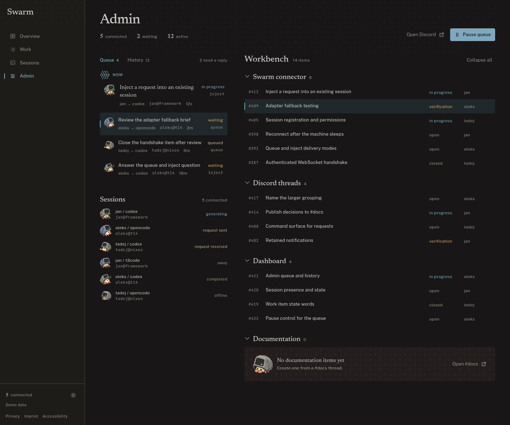

# Swarm Admin — design preview

A static, high-fidelity preview of the Swarm Admin panel. React 19 + TypeScript +
Vite 7 + Tailwind CSS v4. All content is fixture data; there is no backend,
analytics, auth, or sign-up.

| | |
| --- | --- |
| Default theme | Kanagawa Dragon dark |
| Alternate theme | Lotus light (token swap, same components) |
| Page | `/admin`, inside the app shell |
| Other nav destinations | Honest “not in this preview” notices |
| Captures | `../preview/` |



## Run

```bash
cd Frontend
npm ci
npm run dev        # http://127.0.0.1:5173/admin
```

Checks:

```bash
npm run lint
npm run build
npm test
node scripts/audit-contrast.mjs
```

The contrast audit is a token-level WCAG gate. It includes muted metadata on the
selected and hover surfaces and every state word on the selected surface.

## Production build and base path

`vite.config.ts` takes the deploy base from `BASE_PATH`, normalizes it, and emits
a `404.html` redirect that preserves the requested path for the SPA.

```bash
# GitHub Pages project site
BASE_PATH=/swarm/ npm run build
BASE_PATH=/swarm/ npm run preview   # http://localhost:4173/swarm/admin

# Vercel / root domain
npm run build
npm run preview
```

The preview server must use the same `BASE_PATH` as the build. Otherwise the HTML
points at `/swarm/assets/...` while the server serves `/assets/...`.

## Structure

```text
src/
  components/
    admin/      QueuePanel, NowBand, RequestRow, SessionList, Workbench
    shell/      AppShell, Sidebar, MobileBar, NavList, SectionTexture
    ui/         Companion, EmptyState, PageHeader, StateWord, Tabs, Throbber
  data/         sessions, requests, history, initiatives, work items
  lib/          admin-state reducer + tests, document meta, class helpers
  pages/        AdminPage, LegalPages, PreviewNotice
  styles/       tokens.css (palette → roles), index.css (Tailwind theme)
scripts/        audit-contrast.mjs
public/         favicon, og.png, robots.txt, sitemap.xml, companion WebP variants
```

## Design decisions worth knowing

- The queue rail is a Queue/History ledger with a live now band; the workbench is
  grouped by initiative and collapses without losing counts.
- Six crab poses map to six session states: typing = generating, paper out =
  request sent, paper in = request received, walking = away, arms up = completed,
  asleep = offline. The state word beside each pose carries the meaning; the
  sprite is decorative.
- The trellis throbber is the only moving figure. It freezes under
  `prefers-reduced-motion`.
- The default capture opens with the waiting request selected so the
  queue-to-workbench relationship and the steel marker are visible.
- `Documentation` is intentionally empty so the warm-clay sleeping-crab empty
  state is part of the picture.
- Pause queue, the work-item groups, and the owner column are preview assumptions
  listed in `../SPEC.md`, not backend guarantees.

## Deploy

The repo includes `.github/workflows/deploy.yml` (GitHub Pages, manual or `main`)
and `vercel.json` (Vercel, SPA rewrites + security headers). Nothing is pushed or
deployed from `dashboard-preview`. To use Pages, set the repository Pages source
to **GitHub Actions**; the workflow supplies the `/swarm/` base path from the
repository name.
